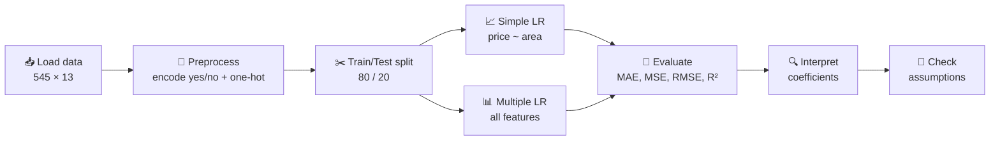
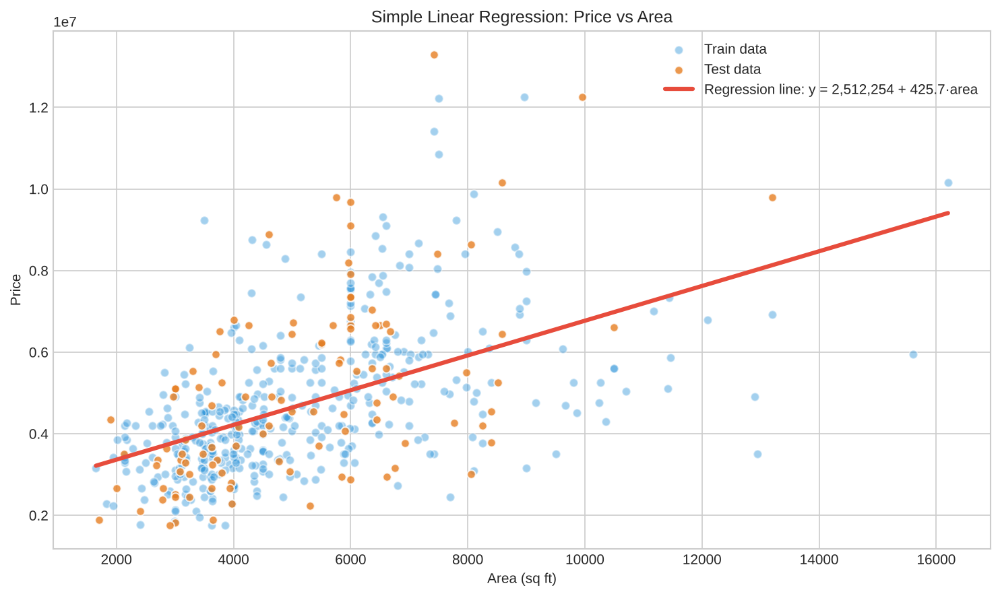
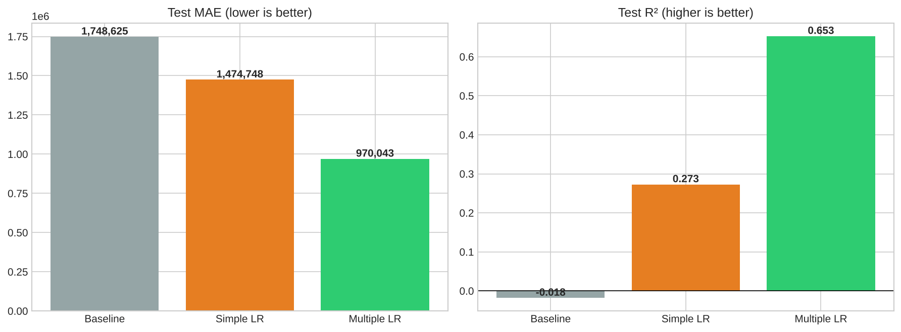
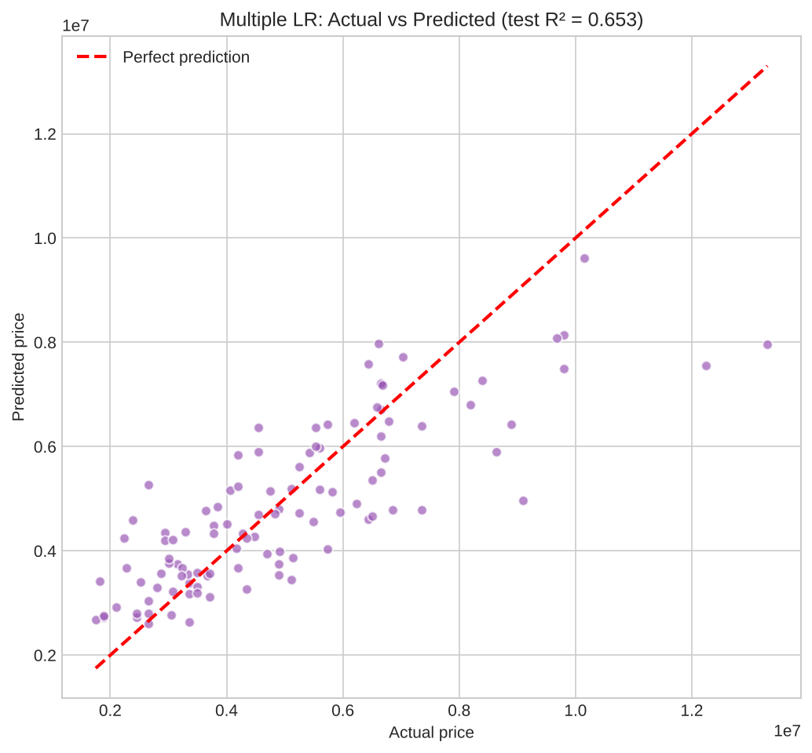
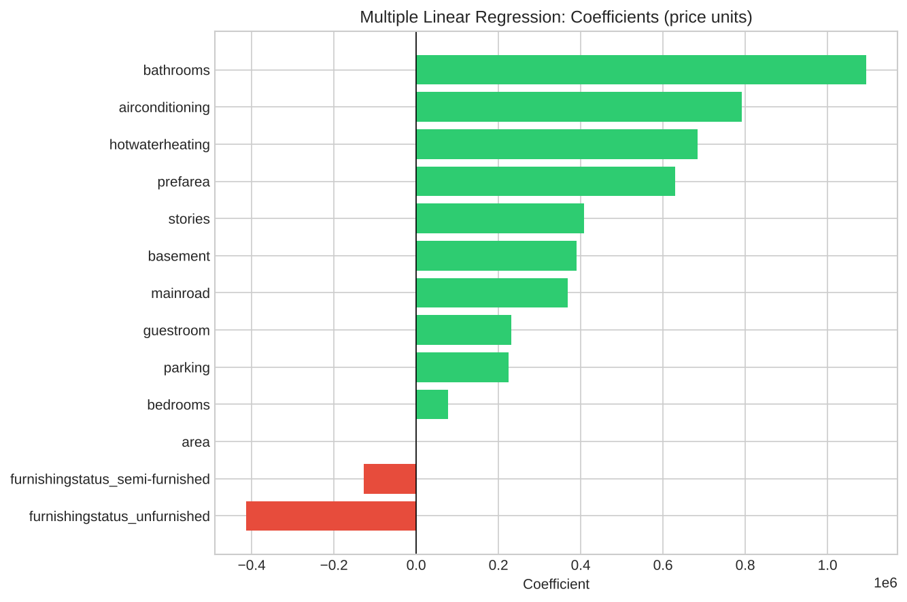
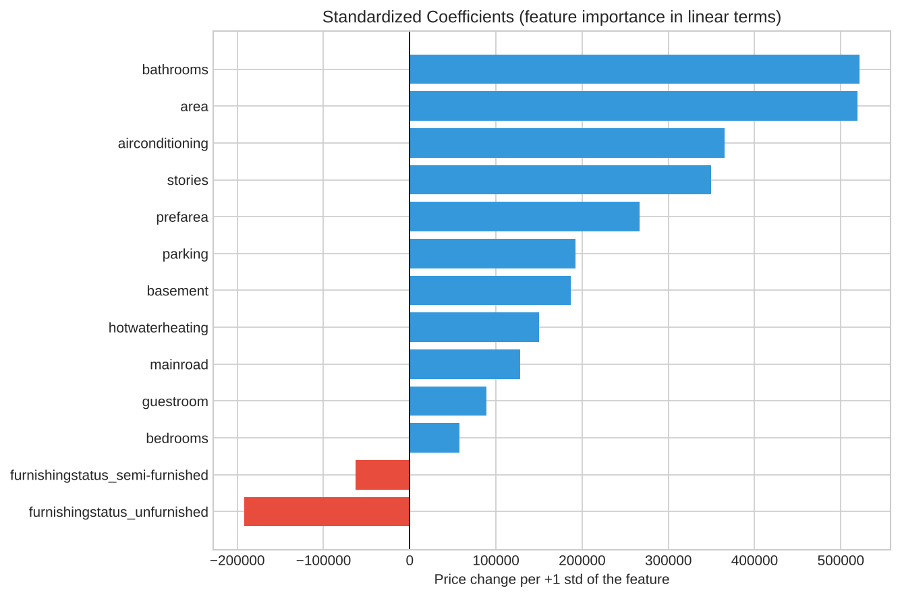
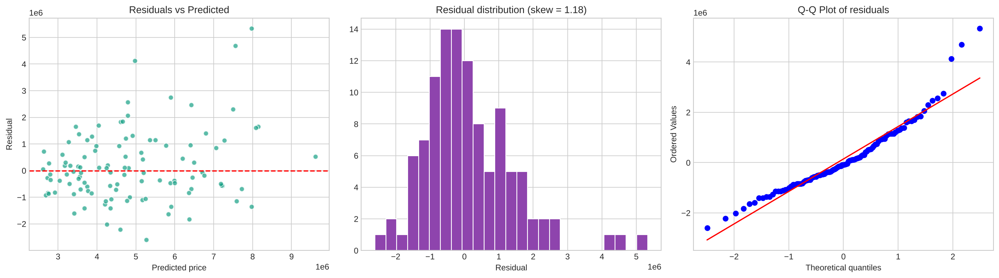
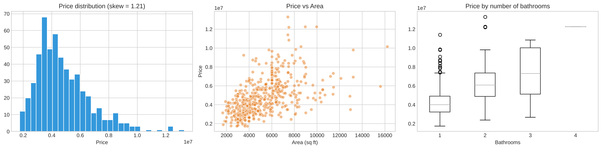
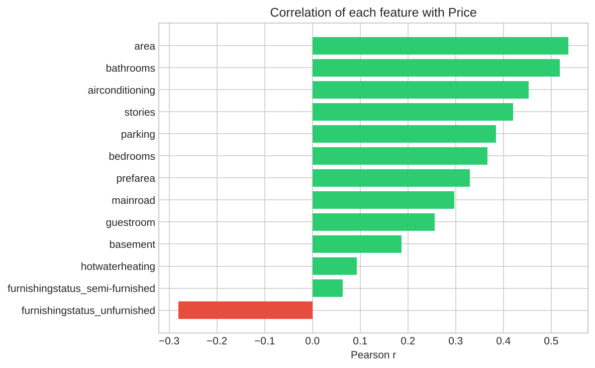
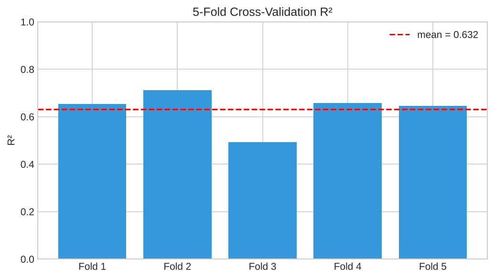

<div align="center">

# 🏠 House Price Prediction with Linear Regression

### Simple & multiple linear regression: from raw data to interpretation


</div>

---

## 🎯 Objective
Implement and understand **simple and multiple linear regression** by predicting house prices: preprocessing, train–test split, model fitting, evaluation (MAE, MSE, RMSE, R²), regression line plotting and coefficient interpretation.

**Dataset:** Housing prices, 545 houses × 13 columns (`price`, `area`, `bedrooms`, `bathrooms`, `stories`, `parking`, plus yes/no amenities and `furnishingstatus`). No missing values, no duplicates.

## ⚡ Highlights

| | |
|---|---|
| 📉 **Simple LR** (`price ~ area`) | Test R² = **0.273**, MAE = 1,474,748 |
| 📊 **Multiple LR** (12 features) | Test R² = **0.653**, MAE = 970,043, RMSE = 1,324,507 |
| 🔁 **5-fold cross-validation** | R² = **0.632 (± 0.074)**, stable, no overfitting |
| 🧮 **Multicollinearity** | All VIF ≤ **1.67**, no issue |
| 🧪 **Assumptions** | Checked with residual plots, Q-Q plot, Shapiro-Wilk and VIF |
| 🔄 **Bonus** | Log-price model compared (R² 0.658, skew −0.12) |

## 🔄 Pipeline



## 📂 Project Structure

```
house-price-linear-regression/
├── 📁 data/
│   └── Housing.csv              # dataset (545 rows, 13 columns)
├── 📁 images/                   # 9 plots generated by the notebook
├── 📓 linear_regression.ipynb   # full notebook with outputs
├── 📄 requirements.txt
└── 📄 README.md
```

## 🧹 Preprocessing
- `mainroad`, `guestroom`, `basement`, `hotwaterheating`, `airconditioning`, `prefarea`: **yes/no → 1/0**
- `furnishingstatus`: **one-hot encoding** with `drop_first=True` (baseline = *furnished*)
- No scaling needed for OLS (standardizing is used only to compare coefficients)
- IQR outliers in `price` (15) and `area` (12) are real houses, so they were **kept**
- Split: **436 train / 109 test**, `random_state=42`

## 📈 Simple Linear Regression
**price = 2,512,254 + 425.73 × area** (fit on the training set)



## 📊 Multiple Linear Regression: Results

| Model | MAE | MSE | RMSE | R² |
|---|---|---|---|---|
| Baseline (predict the mean) | 1,748,625 | 5.15e12 | 2,268,298 | −0.018 |
| Simple LR (train) | 1,092,586 | 2.20e12 | 1,484,836 | 0.285 |
| Simple LR (test) | 1,474,748 | 3.68e12 | 1,917,104 | 0.273 |
| Multiple LR (train) | 719,243 | 9.68e11 | 984,052 | 0.686 |
| **Multiple LR (test)** | **970,043** | **1.75e12** | **1,324,507** | **0.653** |




## 🔍 Coefficient Interpretation
Each coefficient is the change in price for a 1-unit increase, **holding all other features constant**.

| Feature | Coefficient | Meaning |
|---|---|---|
| `bathrooms` | +1,094,445 | Largest raw effect per extra bathroom |
| `airconditioning` | +791,427 | Houses with A/C cost more |
| `hotwaterheating` | +684,650 | Only 25 houses have it, so treat with caution |
| `prefarea` | +629,891 | Preferred-area premium |
| `stories` | +407,477 | Each extra storey |
| `area` | +236 | Each extra sq ft |
| `bedrooms` | +76,779 | Small once area and bathrooms are accounted for |
| `furnishingstatus_unfurnished` | −413,645 | vs furnished baseline |




**Most influential (standardized):** `bathrooms` ≈ `area` > `airconditioning` > `stories` > `prefarea`.

## 🧪 Assumption Checks


| Assumption | Result |
|---|---|
| Linearity | ✅ acceptable |
| Independence | ✅ separate houses, no time order |
| Homoscedasticity | ⚠️ mild funnel shape |
| Normality of residuals | ⚠️ right-skewed (skew 1.18, Shapiro p ≈ 3e-5) |
| No multicollinearity | ✅ all VIF between 1.04 and 1.67 |

A **log(price)** model fixes the residual skew (1.18 → −0.12) with a small accuracy gain (R² 0.658), but the plain model is kept because its coefficients are readable in price units.

## 🖼️ More Visuals




## ▶️ How to Run
```bash
git clone https://github.com/D0027/house-price-linear-regression.git
cd house-price-linear-regression
pip install -r requirements.txt
jupyter notebook linear_regression.ipynb
```
Also runs on Kaggle: add the housing dataset via **+ Add Input** and click **Run All**.

## 🎤 Interview Questions

<details>
<summary><b>1. What assumptions does linear regression make?</b></summary>

Linearity between features and target, independent errors, constant error variance (homoscedasticity), normally distributed residuals (needed for inference, not for fitting) and no severe multicollinearity.
</details>

<details>
<summary><b>2. How do you interpret the coefficients?</b></summary>

Each coefficient is the change in the target for a 1-unit increase in that feature, holding the others constant. The intercept is the prediction when all features are 0. For dummy variables it is the difference from the baseline category. Standardize features to compare importance.
</details>

<details>
<summary><b>3. What is R² and its significance?</b></summary>

R² = 1 − SS_residual / SS_total, the share of target variance the model explains. 1 is perfect and 0 equals predicting the mean (it can go negative on test data). Adjusted R² penalises useless features. A high R² does not by itself mean a good or causal model.
</details>

<details>
<summary><b>4. When would you prefer MSE over MAE?</b></summary>

When large errors are especially costly (MSE squares them), and for optimisation, since MSE is smooth and differentiable and is exactly what OLS minimises. MAE is preferred when outliers should not dominate, and it stays in the original units.
</details>

<details>
<summary><b>5. How do you detect multicollinearity?</b></summary>

The correlation matrix, VIF (> 5 or 10 is a warning), the condition number, and unstable or sign-flipping coefficients. Fix it by dropping or combining features, or by using Ridge regression or PCA.
</details>

<details>
<summary><b>6. What is the difference between simple and multiple regression?</b></summary>

Simple uses one predictor (y = b0 + b1·x, a line). Multiple uses two or more predictors (a hyperplane), and each coefficient is adjusted for the other features.
</details>

<details>
<summary><b>7. Can linear regression be used for classification?</b></summary>

Not well. Outputs are unbounded and are not probabilities, so thresholding is fragile and sensitive to outliers. Logistic regression is the right tool.
</details>

<details>
<summary><b>8. What happens if you violate regression assumptions?</b></summary>

Coefficients may be biased or inefficient, standard errors, p-values and confidence intervals become unreliable, and predictions get worse. Fixes include transforming variables (log), polynomial or interaction terms, robust standard errors, weighted least squares, regularisation, or a non-linear model.
</details>

## 👤 Author

**Deepak Yadav**

[](https://github.com/D0027)
[](https://linkedin.com/in/deepakyadav027)
[](https://d0027.github.io)
